<div align="center">

# 🏦 CondorBank · Red multisede en GNS3

### Diseño y verificación de una red empresarial de tres sedes con VLAN, LACP, HSRP, STP y OSPF multiárea


<sub>Proyecto académico · Grupo 4 · Ingeniería en Tecnologías de la Información<br>Universidad de las Fuerzas Armadas ESPE · Sede Santo Domingo · Noviembre 2026</sub>

<br>

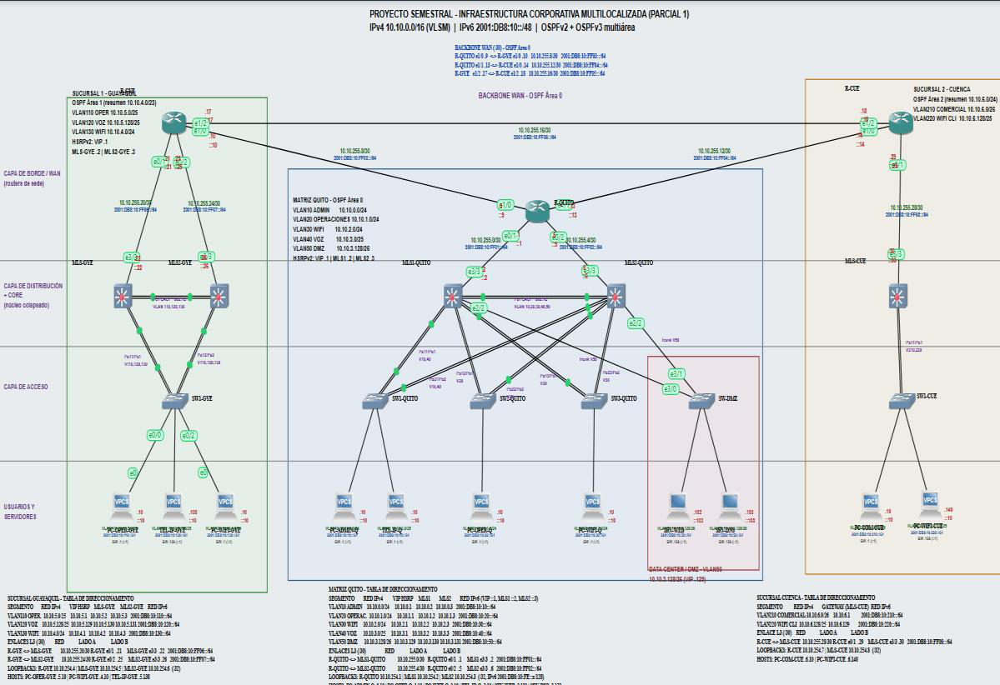

</div>

---

> **Estado:** `v1.0` — primera versión publicada. Incluye topología funcional, configuraciones, informe técnico y 30 capturas de verificación.
>
> **Idea central:** una sola red corporativa para Quito, Guayaquil y Cuenca, con segmentación por VLAN, enlaces agregados LACP, puertas de enlace redundantes con HSRP, árbol de expansión coordinado con el reenvío y enrutamiento OSPF multiárea para IPv4 e IPv6.

<p align="center">
  <a href="docs/Informe_NetDevOps_Grupo4.pdf"><b>📄 Leer el informe completo (25 páginas)</b></a> ·
  <a href="gns3/ProyectoSemestral_NetDevOps.gns3project"><b>⬇️ Descargar el proyecto GNS3</b></a> ·
  <a href="docs/img/"><b>🖼️ Ver las 30 capturas</b></a> ·
  <a href="configs/"><b>⚙️ Explorar las configuraciones</b></a>
</p>

---

## 🎯 ¿Qué es este proyecto?

CondorBank es una simulación de red multisede construida en **GNS3 2.2.57** con dispositivos Cisco IOU, VPCS y contenedores Docker. La matriz está en **Quito**, con las sucursales de **Guayaquil** y **Cuenca** conectadas por una WAN en triángulo.

El proyecto no se queda en el diagrama: cada decisión de diseño se verificó en la consola de los equipos y se contrastó con pruebas de conectividad reales entre sedes, VLAN y servidores. El resultado es una red que **segmenta**, **resume rutas**, **tolera la caída de un conmutador principal** y **mantiene la puerta de enlace disponible**.

| Métrica | Resultado |
|---|---|
| Dispositivos simulados | **25 nodos** y **43 enlaces** |
| Equipos Cisco IOU | **14** (3 routers, 5 switches multicapa, 6 switches de acceso) |
| Segmentos de usuario y servidores | **10 VLAN** en las tres sedes |
| Canales LACP en la matriz | **4** (Po1, Po11, Po12, Po13) |
| Grupos HSRP en la matriz | **10** (5 IPv4 + 5 IPv6) |
| Adyacencias OSPF | **4 vecinos FULL** en OSPFv2 y **4** en OSPFv3 |
| Prueba de caída de MLS1 | **5 paquetes perdidos**, recuperación automática |
| Pruebas de extremo a extremo | **5 escenarios** con respuesta entre sedes y hacia la DMZ |

---

## 🗺️ Topología

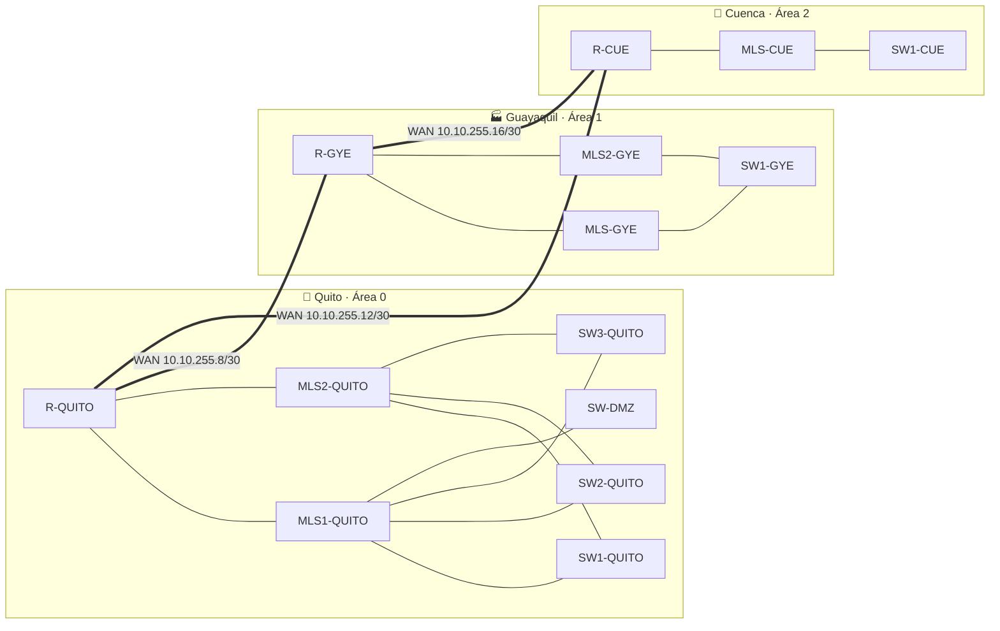

La WAN forma un triángulo: si el enlace directo entre sucursales falla, el tráfico puede pasar por Quito. Las sucursales se anuncian con **un solo resumen IPv4** cada una, mientras que IPv6 se anuncia por prefijo `/64`.

---

## 🧩 Decisiones de diseño

| Área | Decisión | Por qué |
|---|---|---|
| **Direccionamiento** | `10.10.0.0/16` para IPv4 y `2001:DB8:10::/48` para IPv6 | Bloques contiguos por sede que permiten resumir rutas |
| **Dimensionamiento** | VLSM con factor de crecimiento del **20 %** | La telefonía de Quito pasó de 60 a 72 equipos y de `/26` a `/25` |
| **Segmentación** | VLAN 10–50 en Quito, 110–130 en Guayaquil y 210–220 en Cuenca | Aislar usuarios, voz, Wi-Fi, administración y DMZ por función y sede |
| **Enlaces troncales** | 802.1Q con VLAN nativa **999 (NATIVE-BLACKHOLE)** | Evita tráfico sin etiqueta en VLAN de usuarios |
| **Agregación** | LACP en cuatro canales de la matriz y doble acceso en SW1-QUITO | Más ancho de banda y tolerancia a fallos de enlace |
| **Redundancia** | HSRP con reparto activo/activo y `preempt` | MLS1 atiende VLAN 10, 30 y 50; MLS2 atiende 20 y 40 |
| **Capa 2** | STP alineado con los grupos HSRP activos | El camino de capa 2 conduce a la puerta de enlace que realmente reenvía |
| **Enrutamiento** | OSPFv2 multiárea (0/1/2) y OSPFv3 | Resúmenes por sucursal y convergencia ante fallos |
| **Servicios** | DMZ con SRV-WEB y SRV-DNS en la VLAN 50 | Servidores separados del tráfico de usuarios |

---

## 📐 Direccionamiento

### Segmentos locales

| Sede | VLAN | Segmento | Red IPv4 | Puerta de enlace |
|---|---:|---|---|---|
| Quito | 10 | Administración | `10.10.0.0/24` | `10.10.0.1` |
| Quito | 20 | Operaciones | `10.10.1.0/24` | `10.10.1.1` |
| Quito | 30 | Wi-Fi corporativo | `10.10.2.0/24` | `10.10.2.1` |
| Quito | 40 | Telefonía IP | `10.10.3.0/25` | `10.10.3.1` |
| Quito | 50 | DMZ | `10.10.3.128/26` | `10.10.3.129` |
| Guayaquil | 110 | Operaciones | `10.10.5.0/25` | `10.10.5.1` |
| Guayaquil | 120 | Voz | `10.10.5.128/25` | `10.10.5.129` |
| Guayaquil | 130 | Wi-Fi | `10.10.4.0/24` | `10.10.4.1` |
| Cuenca | 210 | Comercial | `10.10.6.0/26` | `10.10.6.1` |
| Cuenca | 220 | Wi-Fi clientes | `10.10.6.128/25` | `10.10.6.129` |

<details>
<summary><b>Ver enlaces de infraestructura, loopbacks y direccionamiento IPv6</b></summary>

### Enlaces punto a punto

| # | Enlace | Red /30 | Lado A | Lado B |
|---:|---|---|---|---|
| 1 | R-QUITO e0/1 ↔ MLS1-QUITO e3/3 | `10.10.255.0/30` | `.1` | `.2` |
| 2 | R-QUITO e0/2 ↔ MLS2-QUITO e3/3 | `10.10.255.4/30` | `.5` | `.6` |
| 3 | R-QUITO e1/0 ↔ R-GYE e1/0 | `10.10.255.8/30` | `.9` | `.10` |
| 4 | R-QUITO e1/1 ↔ R-CUE e1/0 | `10.10.255.12/30` | `.13` | `.14` |
| 5 | R-GYE e1/2 ↔ R-CUE e1/2 | `10.10.255.16/30` | `.17` | `.18` |
| 6 | R-GYE e0/1 ↔ MLS-GYE e3/3 | `10.10.255.20/30` | `.21` | `.22` |
| 7 | R-GYE e0/2 ↔ MLS2-GYE e3/3 | `10.10.255.24/30` | `.25` | `.26` |
| 8 | R-CUE e0/1 ↔ MLS-CUE e3/3 | `10.10.255.28/30` | `.29` | `.30` |

### Router-ID y loopbacks

| Equipo | Loopback0 / Router-ID | Equipo | Loopback0 / Router-ID |
|---|---|---|---|
| R-QUITO | `10.10.254.1/32` | R-GYE | `10.10.254.4/32` |
| MLS1-QUITO | `10.10.254.2/32` | MLS-GYE | `10.10.254.5/32` |
| MLS2-QUITO | `10.10.254.3/32` | MLS2-GYE | `10.10.254.6/32` |
| R-CUE | `10.10.254.7/32` | MLS-CUE | `10.10.254.8/32` |

### IPv6

Cada VLAN recibe un `/64` cuyo cuarto bloque repite el número de VLAN: `2001:DB8:10:10::/64`, `2001:DB8:10:110::/64`, `2001:DB8:10:210::/64`, etc. Las loopbacks usan `/128` (`2001:DB8:10:FE::x/128`) y los enlaces WAN van de `2001:DB8:10:FF01::/64` a `2001:DB8:10:FF08::/64`.

</details>

---

## 📸 Evidencias de funcionamiento

> Las capturas provienen del informe técnico y fueron tomadas directamente de las consolas de los equipos en GNS3.

### 1 · Segmentación, troncales y LACP

<table>
<tr>
<td width="50%">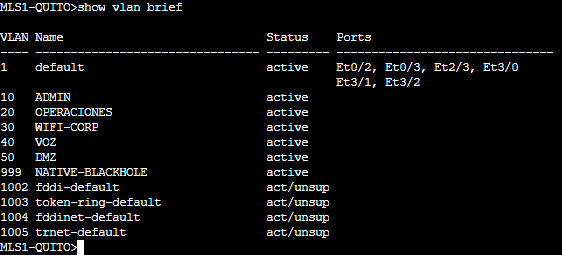<br><sub><b>Figura 2.</b> VLAN 10–50 y VLAN 999 en MLS1-QUITO.</sub></td>
<td width="50%">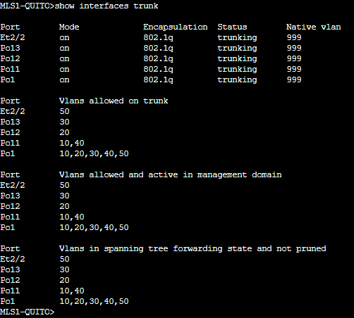<br><sub><b>Figura 3.</b> Troncales 802.1Q con VLAN nativa 999.</sub></td>
</tr>
<tr>
<td>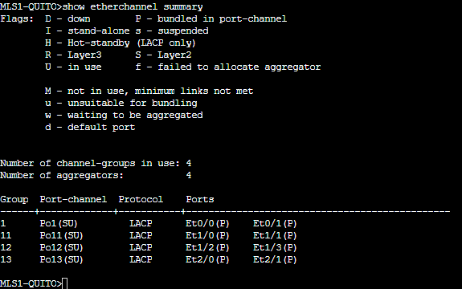<br><sub><b>Figura 4.</b> Cuatro canales LACP en estado <code>SU</code>.</sub></td>
<td>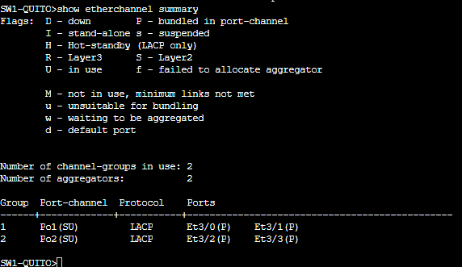<br><sub><b>Figura 5.</b> Doble conexión de acceso en SW1-QUITO.</sub></td>
</tr>
<tr>
<td>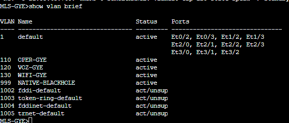<br><sub><b>Figura 6.</b> VLAN 110, 120 y 130 en Guayaquil.</sub></td>
<td>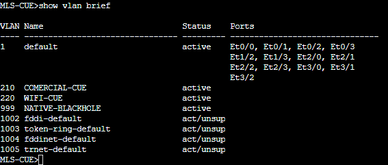<br><sub><b>Figura 7.</b> VLAN 210 y 220 en Cuenca.</sub></td>
</tr>
</table>

<p align="center">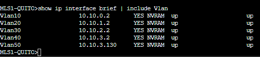<br><sub><b>Figura 8.</b> Cinco SVI en <code>up/up</code>: cada VLAN tiene su punto de enrutamiento.</sub></p>

### 2 · Enrutamiento entre VLAN y redundancia HSRP

<table>
<tr>
<td width="50%">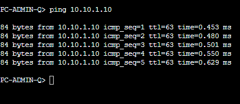<br><sub><b>Figura 9.</b> Administración → Operaciones: 5/5 respuestas, TTL 63.</sub></td>
<td width="50%">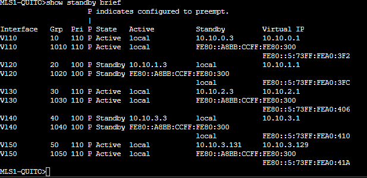<br><sub><b>Figura 10.</b> MLS1 activo en VLAN 10, 30 y 50; en reserva en 20 y 40.</sub></td>
</tr>
<tr>
<td>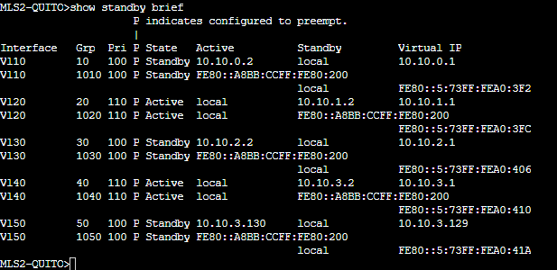<br><sub><b>Figura 11.</b> MLS2 activo en VLAN 20 y 40, con sus pares IPv6.</sub></td>
<td>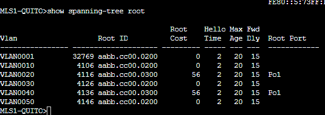<br><sub><b>Figura 12.</b> STP alineado con HSRP: cada equipo es raíz de sus VLAN activas.</sub></td>
</tr>
</table>

**Prueba de caída controlada de MLS1-QUITO**

1. Desde PC-ADMIN-Q se mantuvo un `ping` continuo a PC-OPER-Q (`10.10.1.10`).
2. Se apagó MLS1-QUITO.
3. Las respuestas 1–10 llegaron con normalidad; las solicitudes **11–15 se perdieron**; desde la **16** volvieron las respuestas con TTL 63.
4. Con MLS1 apagado, MLS2 quedó **activo en los 10 grupos HSRP** (5 IPv4 + 5 IPv6).
5. Al recuperar MLS1, volvió a asumir los grupos 10, 30 y 50; el grupo 20 quedó en estado `Speak` al momento de la captura.

<table>
<tr>
<td width="50%">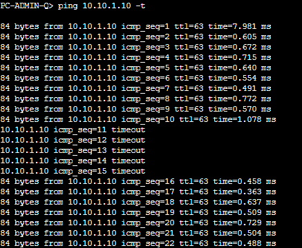<br><sub><b>Figura 13.</b> Cinco respuestas perdidas y recuperación automática.</sub></td>
<td width="50%">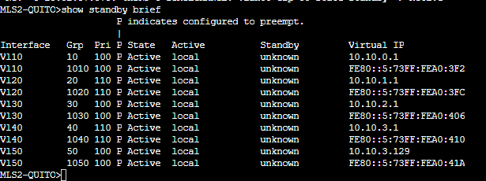<br><sub><b>Figura 14.</b> MLS2 sostiene las diez puertas virtuales durante la caída.</sub></td>
</tr>
</table>

<p align="center">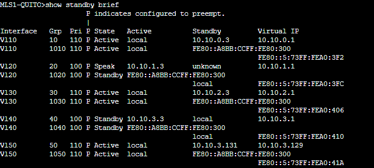<br><sub><b>Figura 15.</b> Restablecimiento del reparto con <code>preempt</code> tras recuperar MLS1.</sub></p>

### 3 · OSPFv2 multiárea y resúmenes de sucursal

<table>
<tr>
<td width="50%">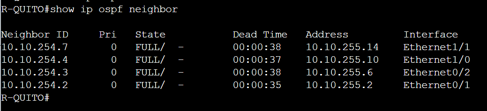<br><sub><b>Figura 16.</b> R-QUITO con cuatro vecinos en estado <code>FULL</code>.</sub></td>
<td width="50%">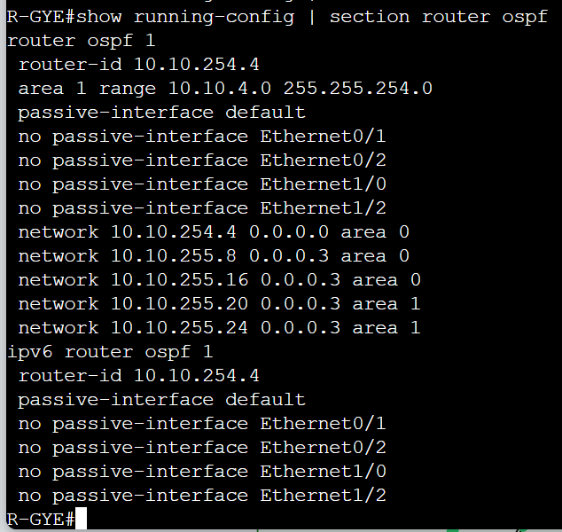<br><sub><b>Figura 18.</b> R-GYE anuncia <code>10.10.4.0/23</code> con <code>area 1 range</code>.</sub></td>
</tr>
<tr>
<td>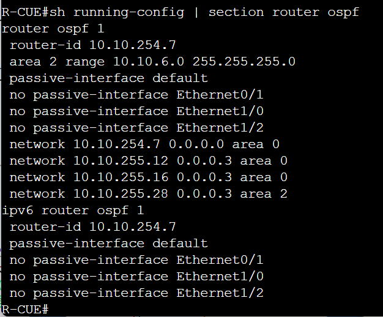<br><sub><b>Figura 19.</b> R-CUE anuncia <code>10.10.6.0/24</code> con <code>area 2 range</code>.</sub></td>
<td>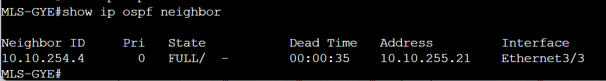<br><sub><b>Figura 20.</b> Adyacencia MLS-GYE ↔ R-GYE en estado <code>FULL</code>.</sub></td>
</tr>
</table>

<p align="center">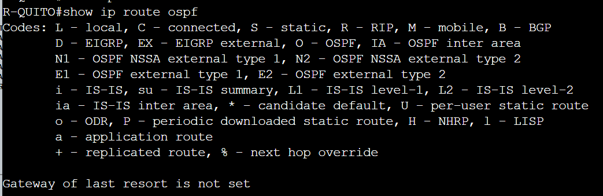<br><sub><b>Figura 17.</b> Quito instala los resúmenes <code>O IA 10.10.4.0/23</code> y <code>O IA 10.10.6.0/24</code>, no los segmentos individuales.</sub></p>

<details>
<summary><b>Ver la tabla de rutas completa (Figura 17b)</b></summary>
<p align="center">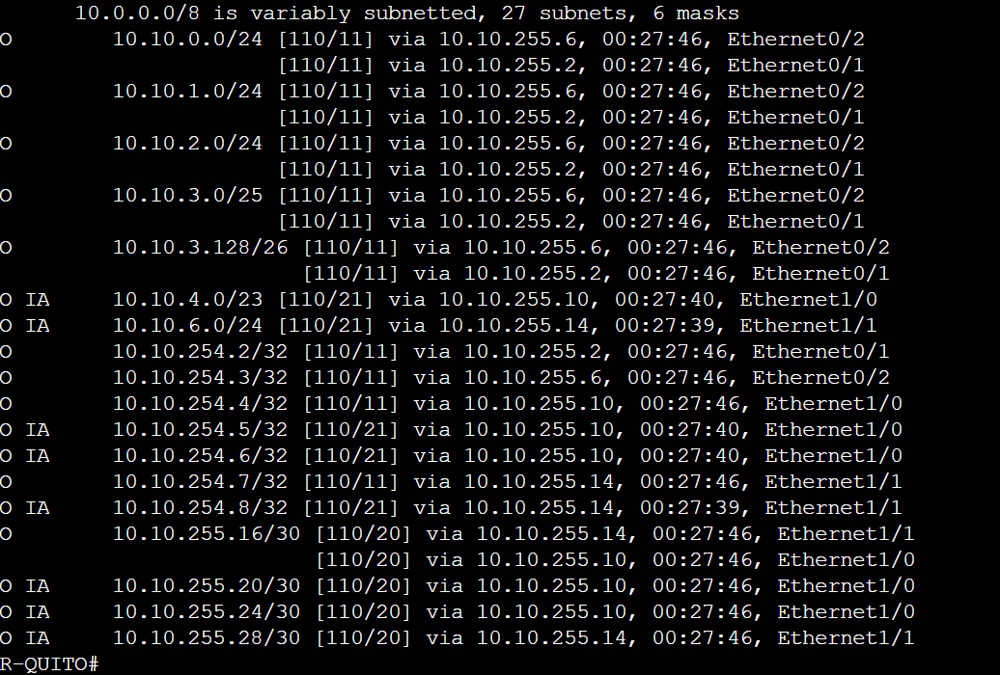</p>
</details>

### 4 · IPv6 y OSPFv3

<table>
<tr>
<td width="50%">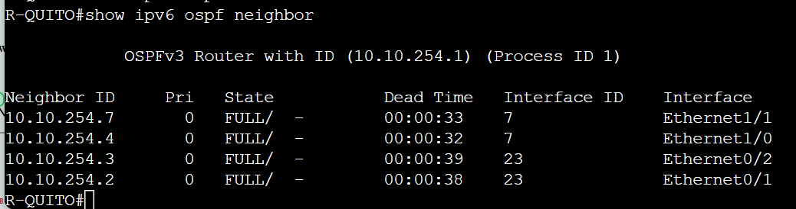<br><sub><b>Figura 21.</b> Cuatro vecinos OSPFv3 <code>FULL</code>, igual que en IPv4.</sub></td>
<td width="50%">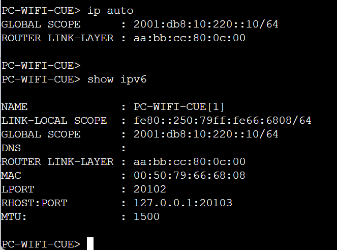<br><sub><b>Figura 23.</b> SLAAC en Cuenca: <code>2001:db8:10:220::10/64</code>.</sub></td>
</tr>
</table>

<p align="center">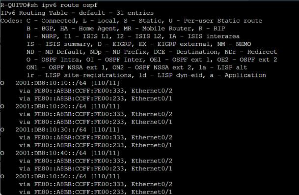<br><sub><b>Figura 22.</b> Quito aprende las VLAN de Guayaquil y Cuenca como <code>OI</code>; cada <code>/64</code> se anuncia por separado.</sub></p>

### 5 · Conectividad extremo a extremo y DMZ

<table>
<tr>
<td width="50%">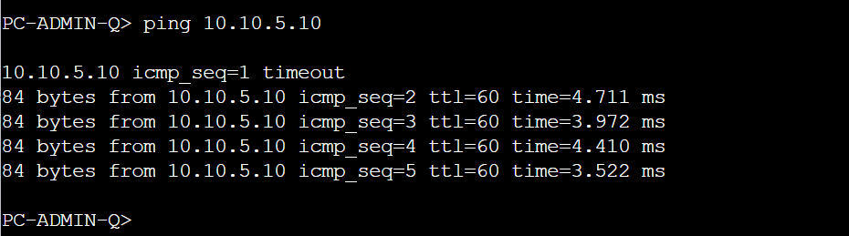<br><sub><b>Figura 24.</b> PC-ADMIN-Q → PC-OPER-GYE: TTL 60.</sub></td>
<td width="50%">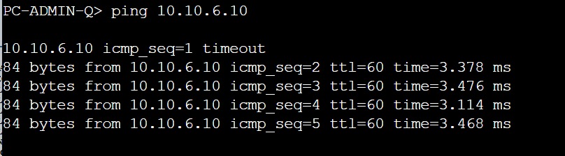<br><sub><b>Figura 25.</b> PC-ADMIN-Q → PC-COM-CUE: TTL 60.</sub></td>
</tr>
<tr>
<td>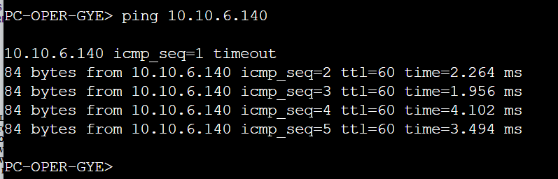<br><sub><b>Figura 26.</b> PC-OPER-GYE → PC-WIFI-CUE: TTL 60.</sub></td>
<td>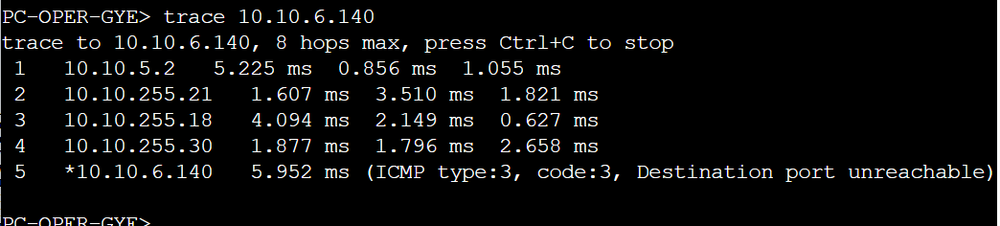<br><sub><b>Figura 27.</b> El trace confirma el enlace directo R-GYE ↔ R-CUE.</sub></td>
</tr>
</table>

<p align="center">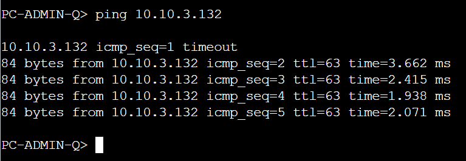<br><sub><b>Figura 30.</b> Quito alcanza SRV-WEB (<code>10.10.3.132</code>) a través de la puerta virtual HSRP de la VLAN 50.</sub></p>

<details>
<summary><b>Ver direccionamiento de los servidores de la DMZ (Figuras 28 y 29)</b></summary>
<table>
<tr>
<td width="50%">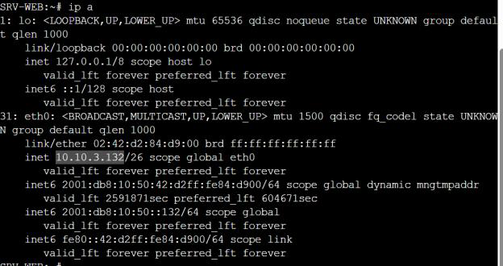<br><sub><b>Figura 28a.</b> SRV-WEB: <code>10.10.3.132/26</code> y <code>2001:db8:10:50::132/64</code>.</sub></td>
<td width="50%">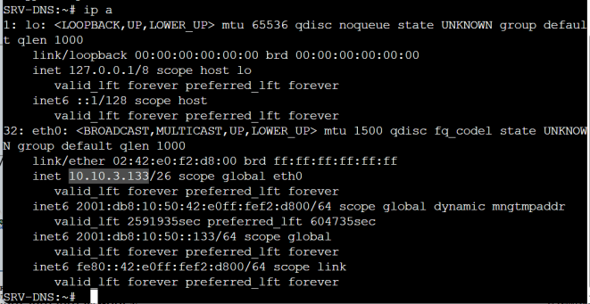<br><sub><b>Figura 29a.</b> SRV-DNS: <code>10.10.3.133/26</code> y <code>2001:db8:10:50::133/64</code>.</sub></td>
</tr>
<tr>
<td>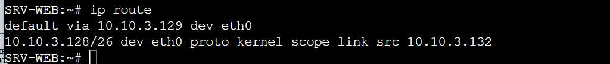<br><sub><b>Figura 28b.</b> Ruta predeterminada por <code>10.10.3.129</code> (HSRP).</sub></td>
<td>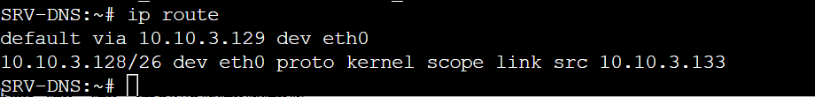<br><sub><b>Figura 29b.</b> Misma puerta virtual en SRV-DNS.</sub></td>
</tr>
</table>
</details>

---

## ✅ Resultados de las pruebas

| Origen | Destino | Resultado | Detalle |
|---|---|---|---|
| PC-ADMIN-Q | PC-OPER-Q · `10.10.1.10` | **5/5** | TTL 63 · 0,45–0,63 ms |
| PC-ADMIN-Q | PC-OPER-GYE · `10.10.5.10` | **4/5** | TTL 60 · 3,5–4,7 ms · el primer paquete resuelve ARP |
| PC-ADMIN-Q | PC-COM-CUE · `10.10.6.10` | **4/5** | TTL 60 · 3,1–3,5 ms |
| PC-OPER-GYE | PC-WIFI-CUE · `10.10.6.140` | **4/5** | TTL 60 · 2,0–4,1 ms |
| PC-ADMIN-Q | SRV-WEB · `10.10.3.132` | **4/5** | TTL 63 · 1,9–3,7 ms |

**Trace de Guayaquil a Cuenca:** `10.10.5.2 → 10.10.255.21 → 10.10.255.18 → 10.10.255.30 → 10.10.6.140`. El tráfico usa el enlace directo **R-GYE ↔ R-CUE** sin pasar por Quito.

**Lo que queda demostrado:**

- ✅ El tránsito entre VLAN y entre sedes funciona con rutas OSPF aprendidas dinámicamente.
- ✅ Los resúmenes IPv4 reducen la tabla de rutas de Quito a un prefijo por sucursal.
- ✅ HSRP mantiene la puerta de enlace disponible ante la caída de MLS1.
- ✅ IPv6 funciona en paralelo con OSPFv3 y autoconfiguración SLAAC.
- ✅ La DMZ es alcanzable desde Quito a través de la puerta virtual de la VLAN 50.

**Límites conocidos de la v1.0** (documentados en el informe):

- La prueba de la DMZ verifica alcance IP; falta una prueba de aplicación HTTP/DNS.
- El estado final del grupo HSRP 20 tras recuperar MLS1 no quedó capturado (aparece en `Speak`).
- IPv6 no usa resumen por sucursal: Quito aprende cada `/64` por separado.
- Los cinco paquetes perdidos durante el failover pueden reducirse ajustando los temporizadores de HSRP.

---

## 🚀 Cómo abrir el proyecto

### Requisitos

| Componente | Versión / imagen |
|---|---|
| GNS3 | **2.2.57** o superior |
| Router IOU | `i86bi_linux-adventerprisek9-ms.155-2.T.bin` |
| Switch multicapa IOU | `i86bi-linux-l2-adventerprisek9-15.2a.bin` |
| Servidores | Docker `gns3/alpinet:latest` |
| Hosts de prueba | VPCS integrado en GNS3 |

### Pasos

1. Descarga [`gns3/ProyectoSemestral_NetDevOps.gns3project`](gns3/ProyectoSemestral_NetDevOps.gns3project).
2. En GNS3: **File → Import portable project** y selecciona el archivo.
3. Verifica que las imágenes IOU y la imagen Docker estén instaladas con los nombres exactos.
4. Arranca los equipos y espera la convergencia de STP, LACP y OSPF (1–2 minutos).
5. Abre las consolas y comprueba el estado:

```text
show vlan brief
show etherchannel summary
show standby brief
show ip ospf neighbor
show ipv6 ospf neighbor
show ip route ospf
show ipv6 route ospf
```

6. En los VPCS, configura la puerta de enlace de su VLAN y prueba:

```text
ip 10.10.0.10/24 10.10.0.1
ping 10.10.1.10
ping 10.10.5.10
ping 10.10.6.10
ping 10.10.3.132
```

### Credenciales de laboratorio

> Para publicar el repositorio se **reemplazaron las credenciales originales** por una credencial de laboratorio conocida:
>
> - Usuario: `admin`
> - Contraseña / `enable secret`: `CondorBank2026!`
>
> Cámbialas antes de reutilizar el proyecto fuera de un entorno aislado.

---

## 📂 Estructura del repositorio

```text
condorbank-netdevops/
├── README.md
├── docs/
│   ├── Informe_NetDevOps_Grupo4.pdf      # Informe técnico (25 páginas)
│   └── img/                              # 35 imágenes extraídas del informe
├── configs/                              # 14 configuraciones, una por equipo
│   ├── R-QUITO.cfg
│   ├── MLS1-QUITO.cfg
│   ├── MLS2-QUITO.cfg
│   ├── R-GYE.cfg
│   ├── MLS-GYE.cfg
│   ├── MLS2-GYE.cfg
│   ├── R-CUE.cfg
│   ├── MLS-CUE.cfg
│   ├── SW1-QUITO.cfg … SW3-QUITO.cfg
│   ├── SW-DMZ.cfg
│   ├── SW1-GYE.cfg
│   └── SW1-CUE.cfg
└── gns3/
    └── ProyectoSemestral_NetDevOps.gns3project   # Proyecto portable listo para importar
```

---

## 🗺️ Roadmap

- [x] **v1.0** · Topología, VLAN, LACP, HSRP, STP, OSPFv2/v3, DMZ, informe y capturas.
- [ ] **v1.1** · Resumen IPv6 por sucursal en los routers de borde.
- [ ] **v1.2** · Prueba de aplicación HTTP y DNS en la DMZ + ajuste de temporizadores HSRP.
- [ ] **v2.0** · Automatización NetDevOps: plantillas de configuración, validación con Ansible/Nornir y pipeline de verificación.
- [ ] **v2.1** · Video demo del failover y de las pruebas extremo a extremo.

Este repositorio se actualizará por versiones: cada avance relevante quedará en un commit y una etiqueta (`v1.0`, `v1.1`, …).

---

## 📚 Documentación y créditos

- **Informe técnico:** [Diseño y verificación de la red multisede de CondorBank en GNS3](docs/Informe_NetDevOps_Grupo4.pdf) — 25 páginas, 30 figuras y 3 tablas.
- **Asignatura:** InterNetWorking · **Grupo 4**
- **Docente:** Alberto Daniel Nuñez Agurto
- **Institución:** Universidad de las Fuerzas Armadas ESPE · Sede Santo Domingo de los Tsáchilas
- **Carrera:** Ingeniería en Tecnologías de la Información
- **Mantenimiento del repositorio:** [@Corinaast](https://github.com/Corinaast)

> **Uso académico y demostrativo.** Las configuraciones corresponden a un laboratorio aislado en GNS3; no están pensadas para producción. El informe y las capturas pertenecen a sus autores.

<div align="center">
<sub>Hecho con 🧠 y muchas consolas abiertas · GNS3 2.2.57 · 2026</sub>
</div>
